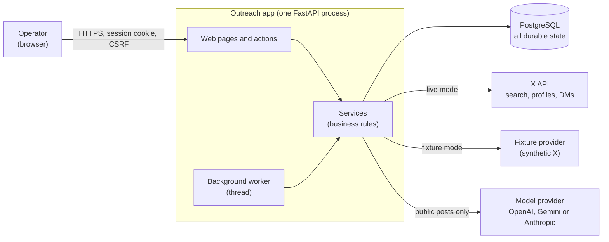
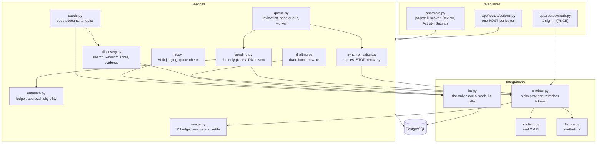
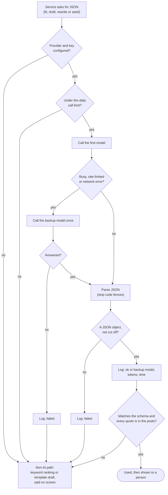
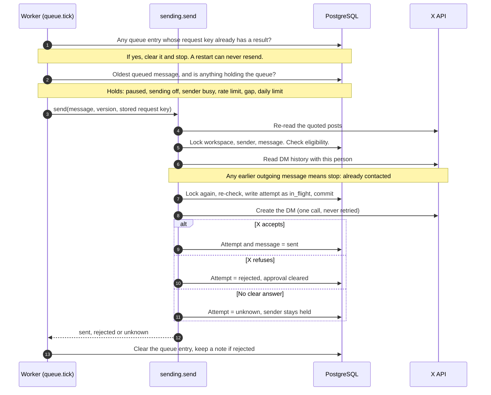
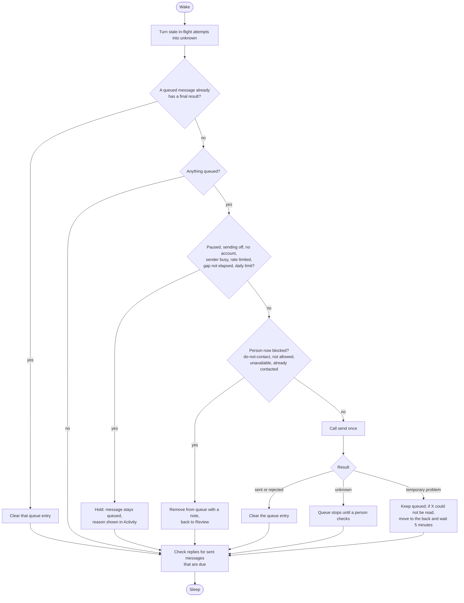
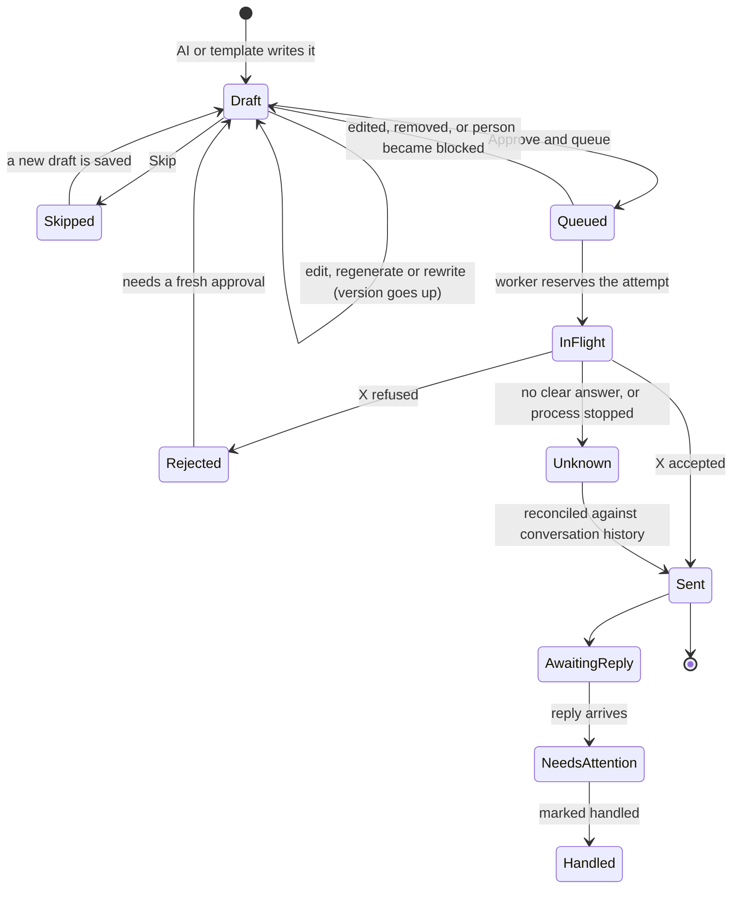
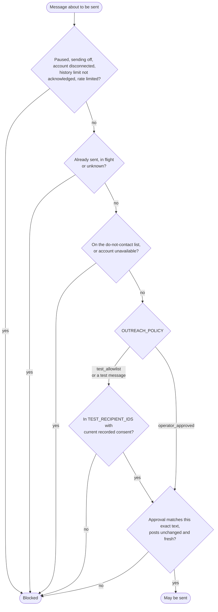
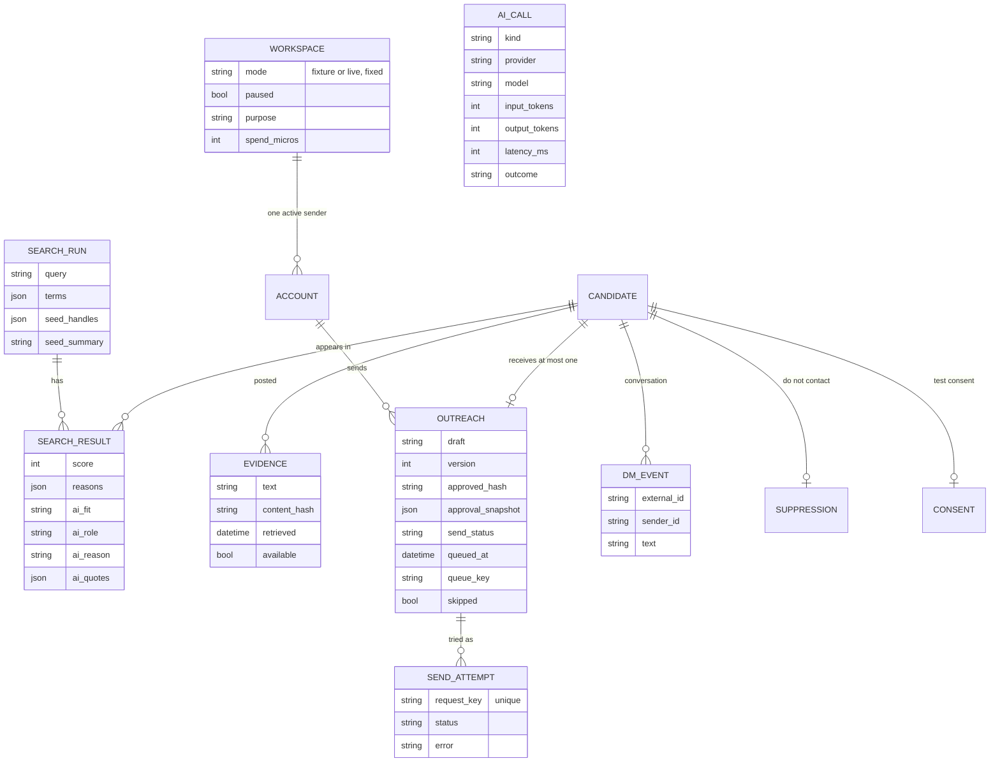

# Architecture

The tool is one Python web application and one PostgreSQL database. AI models read posts and write drafts. A person approves every message. A background thread inside the application sends approved messages at a set pace and checks for replies.

The diagrams below use Mermaid. They render on GitHub and in the VS Code Markdown preview.

## 1. System context

Who and what the application talks to.

- **Two modes.** `APP_MODE=live` uses the real X API. `APP_MODE=fixture` uses a synthetic provider stored in the same database, so the whole flow can run without X. Each database is tied to one mode; the app refuses to start on a mismatch.
- **What leaves the machine.** To X: searches, profile reads, DM reads and the approved message. To a model: public profile text, public posts, the sender name and the purpose. DMs and tokens are never sent to a model.

## 2. Components

| Layer | Rule |
|---|---|
| Web | Parses forms, requires a signed-in session and a CSRF token, calls one service function, redirects. No business rules here. |
| Services | All rules. Each function opens its own short database transactions. |
| Integrations | All network calls. `llm.py` is the single door to models; `runtime.py` is the single door to X. |

## 3. End-to-end flow

From a search to a tracked reply. Blue boxes are AI steps, the orange box is the human decision.

```mermaid
flowchart TD
    start(["Operator starts"]) --> choice{"Start from"}
    choice -- "topics" --> search
    choice -- "seed accounts" --> seedread["Read each seed's bio and recent posts"]
    seedread --> seedai["AI: describe the seeds,<br/>propose search topics"]
    seedai --> topiccheck{"Topics pass the<br/>character rules?"}
    topiccheck -- "none do" --> stop1(["No search is run"])
    topiccheck -- "yes" --> search["One X search<br/>up to 50 recent posts"]
    search --> score["Keyword score<br/>keep top 20 people and their posts"]
    score --> judge["AI: judge the top 10<br/>fit, role, reason, quotes"]
    judge --> qcheck{"Every quote found word<br/>for word in their posts?"}
    qcheck -- "no" --> drop["Discard that judgment<br/>keyword score stands"]
    qcheck -- "yes" --> rank["Order: strong, possible,<br/>unjudged, weak"]
    drop --> rank
    rank --> batch["Draft for top matches<br/>(strong and possible, up to 10)"]
    batch --> draft["AI: write a message<br/>from the person's posts"]
    draft --> dcheck{"Quotes real, 500 characters<br/>or fewer, has STOP line?"}
    dcheck -- "no" --> template["Template draft,<br/>labelled as fallback"]
    dcheck -- "yes" --> review
    template --> review["Review page<br/>person reads reason, quotes, posts, draft"]
    review --> decide{"Decision"}
    decide -- "Rewrite" --> draft
    decide -- "Skip" --> skipped(["Hidden, person not blocked"])
    decide -- "Do not contact" --> blocked(["Suppressed for good"])
    decide -- "Approve and queue" --> queued["Send queue<br/>stored request key"]
    queued --> worker["Worker: one message at a time,<br/>gap and daily limit"]
    worker --> send["Send once through X"]
    send --> track["Reply checks every<br/>AUTO_SYNC_MINUTES for 14 days"]
    track --> attention(["Reply shows under Needs attention<br/>STOP adds to do-not-contact"])

    classDef ai fill:#edf1fc,stroke:#3656d4,color:#20334a
    classDef human fill:#fff0d8,stroke:#98651d,color:#20334a
    class seedai,judge,draft ai
    class review,decide human
```

## 4. How one AI call is made safe

Every model call goes through `complete_json` in `llm.py`, and every answer is checked before it is used.

- **Untrusted text.** Posts and profiles go to the model inside a JSON payload, never inside the instructions, and the instructions say to treat them as data. The model has no tools.
- **What the model can affect.** Only a judgment, a draft, or search topics. Judgments and drafts are checked against stored posts and shown to a person. Topics must pass the same character rules as typed topics, so the model cannot add search operators.
- **Providers.** OpenAI uses the Responses API with `gpt-6-luna` first and `gpt-6.1-terra` as backup and for rewrites. Gemini uses two models. Anthropic is written but untested.
- **Call log.** One `ai_calls` row per request: purpose, provider, model, tokens, time, outcome and an application-authored error code. Provider response bodies are never stored or shown.

## 5. Sending one message

The worker decides when; `sending.send` decides whether. This sequence is the core of duplicate prevention.

Why this cannot send twice:

1. **One row per person.** A unique constraint on sender plus recipient means there is one outreach record per person.
2. **The attempt is committed before the network call.** If the process dies mid-send, the attempt stays `in_flight`; on restart it becomes `unknown`, never "ready to send".
3. **The request key is stored when the message is queued.** Calling `send` again with the same key returns the stored result.
4. **No automatic retries.** An `unknown` result holds the sender and stops the queue until a person reconciles it against the conversation history or freezes the contact.
5. **Row locks.** Two sends racing each other serialize on the workspace, sender and message rows; only one reserves the attempt.

## 6. What the worker does on each wake-up

The worker is a daemon thread started with the app. It wakes every `QUEUE_TICK_SECONDS` (30 by default).

## 7. Life of one message

Two things change independently: the draft and its approval, and the send status.

An approval records the draft's hash and version, sender, recipient, the hashes of the quoted posts, the purpose version and the consent version. If any of them changes, the approval no longer matches and the message cannot be sent until it is approved again.

## 8. Who can be messaged

`eligibility()` in `outreach.py` returns every reason a send is not allowed. An empty list means it may go.

## 9. Data model

- `OUTREACH` is unique on sender plus recipient. That constraint is the contact ledger.
- `SEND_ATTEMPT.request_key` is unique. That is what makes a repeated request return the stored result.
- `AI_CALL` stands alone; it is the log behind the AI usage panel.
- Three Alembic migrations create and extend the schema. 0002 and 0003 only add tables and columns and are safe to repeat.

## 10. Transactions and recovery

- **Lock order:** workspace, sender account, outreach record, then attempt. Every operation that can change eligibility takes the workspace lock, so it cannot interleave with a send reservation.
- **Network calls happen outside transactions.** The reservation commits first; the call to X follows.
- **Recovery:** at start-up and on each worker wake-up, an attempt left `in_flight` longer than `STALE_SEND_SECONDS` becomes `unknown`.
- **Reconciliation:** an `unknown` attempt becomes `sent` only if exactly one matching outgoing event exists in the right conversation and time window. Anything else leaves the hold in place.
- **Token refresh:** a short claim transaction, the exchange with X outside it, then a guarded write. A second caller sees `TOKEN_REFRESH_BUSY`. An interrupted refresh requires reconnecting, because X may already have rotated the token.
- **Reply import:** conversation pages are committed one at a time and events are unique on account plus event id, so a partial failure keeps what was read and a repeat read adds nothing twice.

## 11. Security

| Concern | Measure |
|---|---|
| Operator sign-in | Argon2 password hash, random server-side sessions with expiry, HttpOnly SameSite cookies, login throttling |
| Forged requests | Origin check and a per-session CSRF token on every POST; `next` redirects limited to a fixed list |
| X tokens | OAuth 2 with PKCE and single-use state; tokens encrypted with a key kept outside the database |
| Secrets | Only in `.env`. The packaging script refuses to build if the settings template holds a secret. Tests remove real credentials from their environment |
| Prompt injection | Posts are data inside a JSON payload; the model has no tools; its output is validated and reviewed by a person |
| Error text | Written by the app. Provider response bodies are never shown or stored |
| Browser | Content Security Policy with no inline script, frame blocking, no caching, access logs off so OAuth codes are not logged |

## 12. Why this shape

- **One process, one database.** At ten messages a day and fifty posts a search, a message broker, a separate worker service or a vector database would add failure modes without adding capacity that is needed. PostgreSQL row locks do the coordination.
- **The queue is a column, not a service.** A queued message is an outreach row with `queued_at` and `queue_key` set. Run exactly one app process: more would not double-send, but the design does not rely on them.
- **Everything external has a stand-in.** The fixture provider replaces X and tests replace the model with a function, so 230 tests run with no network.

## 13. Official contracts

Reviewed 2026-11-12 unless noted:

- https://docs.x.com/x-api/direct-messages/manage/integrate
- https://docs.x.com/x-api/direct-messages/lookup/quickstart
- https://docs.x.com/x-api/posts/search-recent-posts
- https://help.x.com/en/rules-and-policies/x-automation
- https://platform.claude.com/docs/en/api/messages/create
- https://ai.google.dev/api/generate-content (Gemini generateContent; called for real on 2026-11-14)
- https://developers.openai.com/api/reference/python/resources/responses/methods/create (OpenAI Responses; read on 2026-11-14, not yet called)
- https://www.postgresql.org/docs/current/explicit-locking.html

What has and has not been run against the real services is recorded in VERIFICATION.md.
